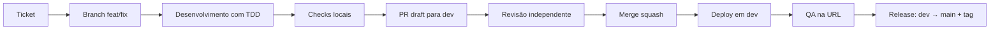

# Workflow de desenvolvimento

## Princípios

- Cada mudança começa por um ticket com critério de aceite observável e link para RF/RN.
- O repositório tem uma branch de integração (`dev`) e uma de produção (`main`).
- A spec é a fonte da verdade; código e spec não divergem em silêncio.
- Tudo que é comportamento tem teste; tudo que é número tem fonte.

## Fluxo

1. **Ticket**: problema, resultado esperado, "Pronto quando", fora de escopo, RF/RN.
2. **Branch**: `feat/<n>-<slug>`, `fix/<n>-<slug>` ou `docs/<slug>`.
3. **Desenvolvimento**: teste que falha → implementação → refatoração. Fixtures novas quando o parser muda.
4. **Checks locais**: `pnpm lint`, `pnpm typecheck`, `pnpm test`, `pnpm test:e2e`, `pnpm build`, `terraform validate` quando aplicável.
5. **PR draft**: descrição com sumário, evidência (antes/depois), testes executados e riscos.
6. **Revisão**: outra pessoa (ou agente revisor) lê o diff e roda uma amostra dos testes.
7. **Merge**: squash em `dev`, após checks verdes e revisão aprovada.
8. **QA**: verificação na URL de dev por quem não implementou.
9. **Release**: PR `dev` → `main` com merge commit, tag `v0.N.0`, deploy em prod.

## Definition of Done

- [ ] Critérios de aceite do ticket verificados com evidência.
- [ ] RF/RN atualizados, se o comportamento mudou.
- [ ] Testes unitários/contrato/e2e verdes; cobertura dentro da meta.
- [ ] Orçamento de bytes e Lighthouse dentro da meta (quando afeta a web).
- [ ] Acessibilidade verificada (axe + teclado) quando há tela.
- [ ] `terraform validate` e plan revisado (quando há infra).
- [ ] Documentação e matriz de rastreabilidade atualizadas.
- [ ] Nenhum segredo, nenhum dado pessoal, nenhum número inventado.
- [ ] QA na URL publicado, por outra pessoa.

## Cadência

- Semanal, com uma janela de release.
- Hotfix vai direto para `main` a partir de `fix/`, com tag de patch e retorno para `dev`.
- Congelamento de `dev` nas 24 h anteriores a uma eleição.

## Exceções

Uma regra pode ser quebrada com justificativa registrada no PR: princípio afetado, motivo, escopo, mitigação, aprovador e prazo. Exceção sem prazo volta a bloquear.
