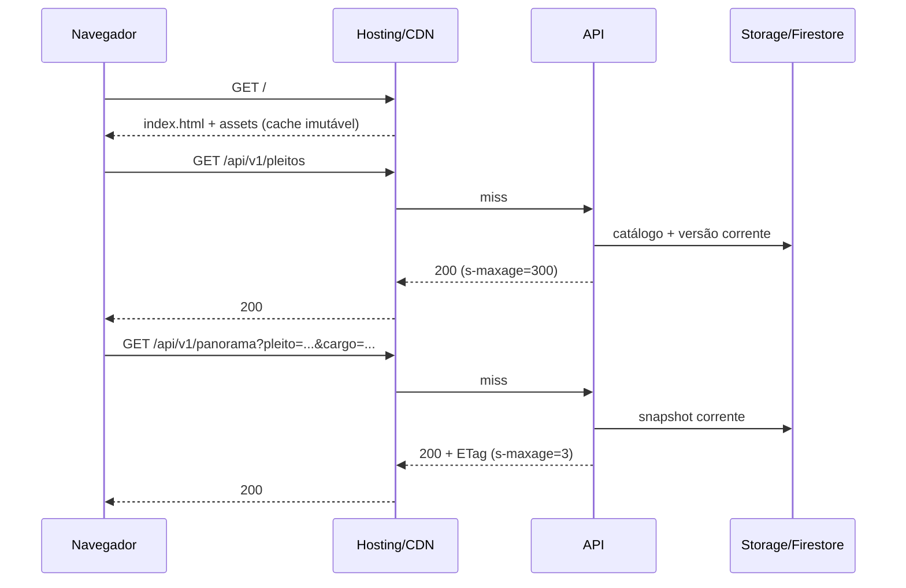
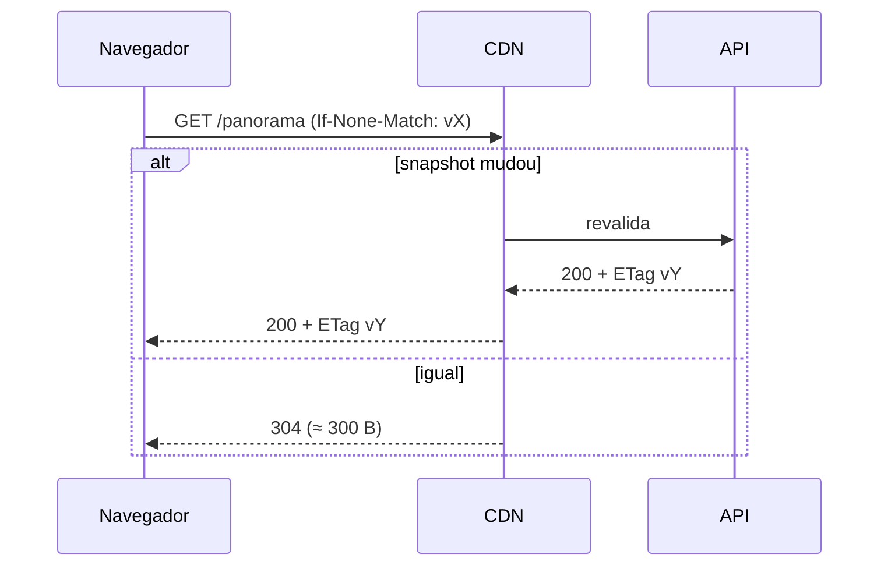
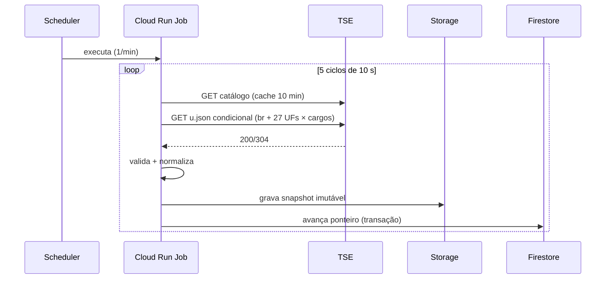

# 08 — Arquitetura e stack

## 1. Visão em camadas

```
Navegador (SPA React)
   │  fetch /api/v1/*  (ETag, cache)
   ▼
Firebase Hosting (CDN global, TLS, rewrite /api → Cloud Run)
   │
   ▼
Cloud Run · api (Fastify/Node 22)
   │            └── cache em memória (LRU) + ETag
   ├── Firestore (config: pleitos ativos, versão corrente, cores, localidades)
   └── Cloud Storage (snapshots imutáveis, catálogo, geo, fixtures)
   ▲
   │ publica snapshots
Cloud Run Job · ingest (a cada 1 min, com ciclos internos de 10 s)
   │  HTTP condicional, ≤ 5 rps
   ▼
resultados.tse.jus.br (arquivos oficiais)
```

O navegador nunca fala com o TSE. Todo dado servido é normalizado, versionado e cacheável.

## 2. Estrutura do monorepo

```
pulso-das-urnas/
├── apps/
│   ├── web/                  # React 19 + Vite SPA
│   ├── api/                  # Fastify 5, leitura de snapshots
│   └── ingest/               # job de coleta e normalização
├── packages/
│   ├── domain/               # tipos, regras puras (RN), cálculo de cor/corrida
│   ├── tse/                  # parser, normalizador, cliente HTTP, fixtures
│   ├── contracts/            # Zod + OpenAPI + tipos gerados
│   ├── geo/                  # build do TopoJSON, centroides, projeção
│   └── testing/              # fixtures, geradores determinísticos, helpers
├── data/
│   ├── party-colors.json
│   ├── geo/                  # br.topo.json + uf/*.topo.json (versionados)
│   └── fixtures/             # respostas reais do TSE (2026, 2024)
├── infra/terraform/          # módulos + ambientes dev/prod
├── docs/                     # requisitos, ADRs, agentes, specs
├── scripts/                  # geo, skills:sync, budget, smoke
└── .opencode/ .github/       # agentes e skills
```

Gerenciador: **pnpm workspaces**. Sem Turborepo na v1 (o custo de configuração supera o ganho em 3 apps).

## 3. Stack

| Camada | Escolha | Justificativa | Alternativas descartadas |
|---|---|---|---|
| UI | React 19 + TypeScript + Vite | ecossistema, code-splitting, build rápido | Next.js (SSR desnecessário, mais peso/custo), Svelte (menor, mas equipe React) |
| Dados no cliente | TanStack Query | cache, dedupe, retry, foco/visibilidade | SWR (menos controle), Redux (peso) |
| Roteamento/estado | React Router + URL como fonte da verdade | deep link, voltar do navegador | estado global próprio (duplicaria a URL) |
| Mapa | SVG + `d3-geo` + `topojson-client` | leve, acessível, clicável por elemento, sem WebGL | MapLibre GL (≈ 200 KB + tiles), Leaflet (raster, pesado) |
| Animação | CSS transitions + WAAPI + mola própria (~1 KB) | 60 fps sem biblioteca | Framer Motion (≈ 35 KB gz), GSAP (licença/peso) |
| API | Fastify 5 + Zod + OpenAPI | baixo overhead, schema-first, tipagem | Express (mais lento), Nest (peso) |
| Runtime | Node 22 (LTS) | disponível no Cloud Run, mesmas libs no ingest | Deno/Bun (risco de compatibilidade) |
| Ingestão | TypeScript no mesmo monorepo | reuso do parser e tipos | Python (duplicaria contrato) |
| Persistência | Firestore + Cloud Storage | free tier, sem servidor, leitura rápida | Postgres (custo fixo), Redis (custo fixo), BigQuery (overkill v1) |
| Infra | Terraform 1.9+ | exigência do projeto, estado remoto no GCS | Pulumi, Deployment Manager |
| CI/CD | GitHub Actions + WIF | sem chave JSON, integra com GCP | chaves de serviço (risco) |

## 4. Componentes do frontend

```
App
├── Layout (header, footer, skip link)
├── ElectionProvider (pleito/cargo da URL)
├── MapView
│   ├── BrazilMap | StateMap  (SVG, d3-geo)
│   ├── Tooltip
│   └── Legend
├── SearchCombobox (localidades)
├── ScopePanel (candidatos, abas, resumo)
├── DataTable (alternativa acessível)
├── RaceTrack (cavalos)
└── FreshnessBadge
```

Regras:
- Nenhum componente calcula cor ou líder: recebe pronto da API. Cálculo local só para animação (interpolação visual).
- O estado de navegação vive na URL; o estado de UI (sheet aberto, pausa) vive em `useState`/`localStorage`.
- Dados por `useQuery` com `staleTime` igual ao intervalo de atualização e `refetchInterval` condicionado à visibilidade.

## 5. Fluxos

### 5.1 Carga inicial


### 5.2 Atualização


### 5.3 Ingestão


## 6. Cache em três níveis

| Nível | O que guarda | TTL | Invalidação |
|---|---|---|---|
| Navegador | respostas HTTP + TopoJSON | `max-age` da rota | ETag/versão |
| CDN (Hosting) | respostas `/api/v1/*` | `s-maxage` 2–5 s | troca de versão |
| API (memória) | snapshots normalizados + geo | LRU 200 itens / 5 min | versão corrente |

- `Cache-Control` é definido por rota ([06](06-contrato-de-dados-tse.md)).
- Chave de cache inclui todos os parâmetros normalizados; parâmetro desconhecido → 400 (não polui cache).
- `Vary: Accept-Encoding` apenas.

## 7. Tratamento de falhas

| Falha | Comportamento |
|---|---|
| TSE lento/fora | Ingestão mantém último snapshot; API serve com selo; alerta após 5 min |
| Firestore indisponível | API usa cache em memória; se vazio, 503 com `Retry-After` |
| Storage indisponível | API usa cache; se vazio, 503 |
| CDN miss em pico | API responde do LRU; limite de instâncias protege o orçamento |
| Snapshot corrompido | Schema invalida a gravação; ponteiro não avança; alerta |
| Cliente offline | Última resposta em cache do TanStack Query + faixa de offline |

## 8. Segurança

- Superfície pública e somente leitura; sem autenticação de usuário.
- Segredos: nenhum no cliente; WIF para o CI; nenhuma chave de serviço versionada.
- Container distroless, non-root, somente leitura no filesystem.
- Rate limit na API (60 req/min/IP) e limite de instâncias como proteção de custo.
- CSP sem `unsafe-inline`; estilos críticos inline com hash quando inevitável.
- Dependências: lockfile, Dependabot, `pnpm audit` no CI, SBOM.

## 9. Decisões resumidas

| ID | Decisão |
|---|---|
| ADR-001 | React + Vite + SVG/d3-geo, sem framework SSR e sem WebGL |
| ADR-002 | Ingestão em job de 1 min com ciclos internos de 10 s e cache condicional |
| ADR-003 | TopoJSON simplificado e versionado, gerado no build |
| ADR-004 | Simulador embutido na API via fonte plugável, sem serviço extra |
| ADR-005 | Firebase Hosting + Cloud Run, sem load balancer dedicado |
