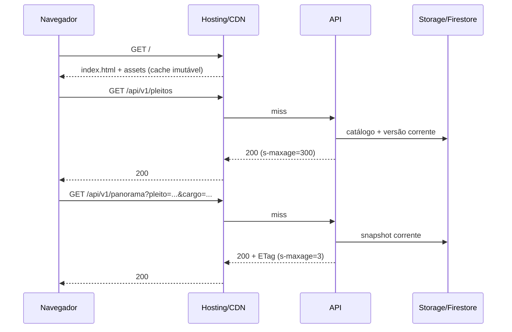
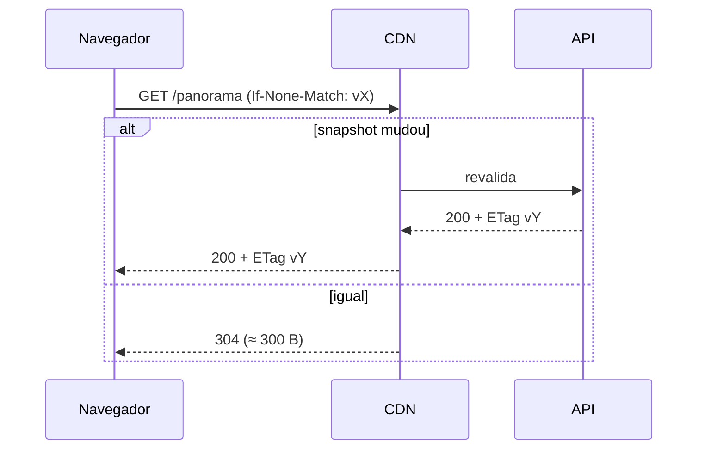
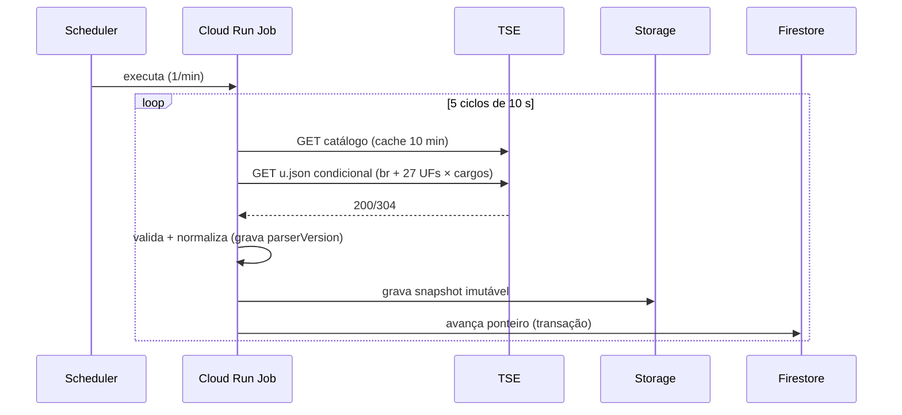
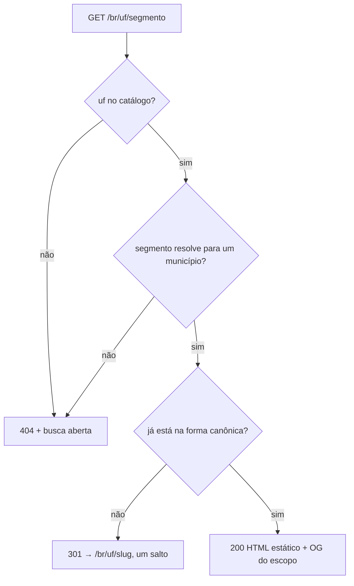
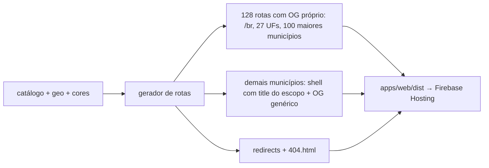

# 08 — Arquitetura e stack

## 1. Visão em camadas

```
Navegador (SPA React)
   │  fetch /api/v1/*  (ETag, cache)
   ▼
Firebase Hosting (CDN global, TLS, rewrite /api → Cloud Run,
                  301 canônico, HTML + OG pré-renderizados)
   │
   ▼
Cloud Run · api (Fastify/Node 22)
   │            └── cache em memória (LRU) + ETag
   ├── Firestore (config: pleitos ativos, versão corrente, cores, localidades)
   └── Cloud Storage (snapshots imutáveis, catálogo, geo, fixtures)
   ▲
   │ publica snapshots
Cloud Run Job · ingest (a cada 1 min, com ciclos internos de 10 s)
   │  HTTP condicional, ≤ 5 rps
   ▼
resultados.tse.jus.br (arquivos oficiais)
```

O navegador nunca fala com o TSE. Todo dado servido é normalizado, versionado e cacheável.

## 2. Estrutura do monorepo

```
pulso-das-urnas/
├── apps/
│   ├── web/                  # React 19 + Vite SPA (build gera HTML/OG/redirects)
│   ├── api/                  # Fastify 5, leitura de snapshots
│   └── ingest/               # job de coleta e normalização
├── packages/
│   ├── domain/               # tipos, regras puras (RN), cálculo de cor/corrida
│   ├── tse/                  # parser, normalizador, cliente HTTP, fixtures
│   ├── contracts/            # Zod + OpenAPI + tipos gerados
│   ├── geo/                  # build do TopoJSON, centroides, projeção
│   └── testing/              # fixtures, geradores determinísticos, helpers
├── data/
│   ├── party-colors.json
│   ├── geo/                  # br.topo.json + uf/*.topo.json (versionados)
│   └── fixtures/             # respostas reais do TSE (2026, 2024)
├── infra/terraform/          # módulos + ambientes dev/prod
├── docs/                     # requisitos, ADRs, agentes, specs
├── scripts/                  # geo, skills:sync, budget, smoke
└── .opencode/ .github/       # agentes e skills
```

Gerenciador: **pnpm workspaces**. Sem Turborepo na v1 (o custo de configuração supera o ganho em 3 apps).

## 3. Stack

| Camada | Escolha | Justificativa | Alternativas descartadas |
|---|---|---|---|
| UI | React 19 + TypeScript + Vite | ecossistema, code-splitting, build rápido | Next.js (SSR desnecessário, mais peso/custo), Svelte (menor, mas equipe React) |
| Dados no cliente | TanStack Query | cache, dedupe, retry, foco/visibilidade | SWR (menos controle), Redux (peso) |
| Roteamento/estado | React Router + URL como fonte da verdade | deep link, voltar do navegador | estado global próprio (duplicaria a URL) |
| Mapa | SVG + `d3-geo` + `topojson-client` | leve, acessível, clicável por elemento, sem WebGL | MapLibre GL (≈ 200 KB + tiles), Leaflet (raster, pesado) |
| Animação | CSS transitions + WAAPI + mola própria (~1 KB) | 60 fps sem biblioteca | Framer Motion (≈ 35 KB gz), GSAP (licença/peso) |
| API | Fastify 5 + Zod + OpenAPI | baixo overhead, schema-first, tipagem | Express (mais lento), Nest (peso) |
| Runtime | Node 22 (LTS) | disponível no Cloud Run, mesmas libs no ingest | Deno/Bun (risco de compatibilidade) |
| Ingestão | TypeScript no mesmo monorepo | reuso do parser e tipos | Python (duplicaria contrato) |
| Persistência | Firestore + Cloud Storage | free tier, sem servidor, leitura rápida | Postgres (custo fixo), Redis (custo fixo), BigQuery (overkill v1) |
| Infra | Terraform 1.9+ | exigência do projeto, estado remoto no GCS | Pulumi, Deployment Manager |
| CI/CD | GitHub Actions + WIF | sem chave JSON, integra com GCP | chaves de serviço (risco) |

## 4. Componentes do frontend

```
App
├── Layout (header, footer, skip link)
├── ElectionProvider (pleito/cargo da URL)
├── MapView
│   ├── BrazilMap | StateMap  (SVG, d3-geo)
│   ├── Tooltip
│   └── Legend
├── SearchCombobox (localidades)
├── ScopePanel (candidatos, abas, resumo)
├── DataTable (alternativa acessível)
├── RaceTrack (cavalos)
└── FreshnessBadge
```

Regras:
- Nenhum componente calcula cor ou líder: recebe pronto da API. Cálculo local só para animação (interpolação visual).
- O estado de navegação vive na URL; o estado de UI (sheet aberto, pausa) vive em `useState`/`localStorage`.
- Dados por `useQuery` com `staleTime` igual ao intervalo de atualização e `refetchInterval` condicionado à visibilidade.
- `ScopePanel` carrega **um cargo por vez**: uma consulta por aba, ≤ 12 KB gz por resposta, pré-busca apenas do cargo em destaque e no máximo 5 abas por município (RF-021, RNF-PERF-06, D-016). A lista completa de cargos nunca é buscada para montar abas — as abas vêm do catálogo.
- Trocar de aba reaproveita a chave de cache `(pleito, escopo, cargo)` do TanStack Query e **não** refaz o mapa: o mapa é alimentado pelo panorama, o painel pela consulta do cargo.
- O roteador não normaliza URL: consome a forma canônica que o Hosting entrega após o `301` e usa `history.replaceState` apenas para o estado de UI (`?cargo=`), nunca para trocar o escopo (RN-041, D-040).

## 5. Fluxos

### 5.1 Carga inicial


### 5.2 Atualização


### 5.3 Ingestão


**Versão do parser e rollback (D-050).** Toda gravação carrega `parserVersion` semver (`MAJOR.MINOR.PATCH`, RN-042) no snapshot e no envelope da API; o parser é uma dependência versionada de `packages/tse`, não uma configuração de request.
- Falha de schema não grava e não avança o ponteiro: registra `parser_schema_failure`, alerta e segue servindo o último snapshot válido.
- `PARSER_VERSION_PIN=<versao>` é lido **no bootstrap** do Cloud Run Job (variável de ambiente da revisão), nunca no handler, e força a versão anterior. Trocar o pin é atualizar a env var da revisão: **sem rebuild de imagem nem deploy de código**, e auditado no log.
- Promover um parser exige todas as fixtures aprovadas e diff contra a saída da versão anterior; o rollback completo (reprocessar fixtures e republicar o ponteiro) está no runbook.
- A API é agnóstica: serve snapshots de qualquer `parserVersion` e expõe o campo; não reinterpreta nem recalcula o que o parser produziu.

### 5.4 Ausência de dado não é erro (D-013)

Escopo válido sem arquivo do TSE é **conteúdo**, não falha: a API responde `200` com `dados: null` e `status: "sem_dado"`, com o mesmo `Cache-Control` de uma resposta `ok`.

| Situação | HTTP | Corpo | Cache |
|---|---|---|---|
| Pleito, turno, cargo **fora do catálogo** ou escopo inexistente | `404` | Problem Details (`PLEITO_NAO_ENCONTRADO`, `ESCOPO_NAO_ENCONTRADO`) | curto (`s-maxage=60`), para não fixar resposta negativa |
| Cargo se aplica, nenhum arquivo coletado | `200` | `status:"sem_dado"`, `dados:null` | igual ao `ok` |
| Arquivo existe, zero voto válido | `200` | `status:"sem_voto"`, `dados` com zeros (nunca `null`) | igual ao `ok` |
| Cargo existe no catálogo mas não se aplica ao escopo/turno | `200` | `status:"nao_aplicavel"`, `dados:null` | igual ao `ok` |
| Nada para servir e fonte fora | `503` | Problem Details (`FONTE_INDISPONIVEL`) + `Retry-After` | `no-store` |

`SEM_DADOS` deixa de existir na tabela de erros ([06](06-contrato-de-dados-tse.md) §4): o estado viaja no campo `status` do envelope, que a tela já usa para cor e microcopy (RN-028, RN-035). A camada de serviço nunca converte ausência em `404` nem em erro de fonte — só o catálogo decide `404`.

### 5.5 Canonicalização de URL (D-040)

A URL canônica é `/br/{uf}/{slug}` — UF minúscula e slug ASCII de RN-041. A canonicalização acontece **antes da SPA**, para que o `301` seja status de servidor de verdade e fique cacheado na borda:



- A tabela de redirecionamento é **gerada no build** a partir do catálogo (código IBGE, alias e variantes de caixa/acento do conjunto pré-renderizado) e publicada como `redirects` do Hosting: finita, determinística, sem código no caminho do request.
- `301` preserva `pleito` e `cargo` da query, sai com `Cache-Control: public, max-age=3600, s-maxage=86400` e nunca encadeia dois saltos.
- **Limite declarado:** forma não canônica fora da tabela (município criado depois do último deploy) é resolvida pela SPA contra `/api/v1/localidades` com `location.replace`; o deploy seguinte a promove a `301`. É o custo de não haver SSR (ADR-001) — o caso raro degrada para redirect de cliente, nunca para tela branca.
- Homônimos sempre com UF; `/br/{slug}` sem UF → `404` com busca. Caminho desconhecido é servido pelo `404.html` estático gerado no build (status `404` real), com a busca aberta e sem tela branca (RF-045).

### 5.6 Pré-renderização de compartilhamento (OG/Twitter) (D-052)

Crawler social não executa JavaScript: metatag tem de estar no HTML entregue. O build gera um arquivo por rota, sem compute por request:



| Conjunto | Título/descrição | Imagem |
|---|---|---|
| `/br` | panorama do pleito corrente | `og-default.png` versionada por build |
| 27 UFs | nome do estado e cargo em destaque | idem |
| 100 maiores municípios por eleitorado | nome do município + UF | idem |
| Demais municípios | `title` com o nome do escopo; OG genérico | idem |

- **Limite declarado:** OG específico só nas 128 rotas acima; os ≈ 5,5 mil municípios restantes compartilham a mesma imagem e descrição genérica, com o nome no `<title>`. Fora do conjunto, o cartão social não mostra votos, líder nem percentual — e isso é aceitável (RF-043).
- **Por que não há SSR:** ADR-001 descarta servidor Node para o frontend (custo e complexidade sem ganho de SEO); o preço é esse corte. Gerar um shell por município ainda garante `title` correto e `404` real sem renderização por request, e o conjunto pré-renderizado usa só dados de catálogo, não de apuração.
- A imagem OG não carrega número, líder nem cor de partido: dado muda a cada ~10 s, o crawler cacheia por dias e número no cartão envelheceria errado (RN-013) e abriria risco de neutralidade (RN-033).
- Todo HTML estático inicial — inclusive os shells — traz atribuição, horário e aviso de não oficialidade fora do React (RF-044, D-039).

## 6. Cache em três níveis

| Nível | O que guarda | TTL | Invalidação |
|---|---|---|---|
| Navegador | respostas HTTP, TopoJSON, HTML pré-renderizado | `max-age` da rota | `ETag`/versão |
| CDN (Hosting) | respostas `/api/v1/*` de resultado | `s-maxage` da rota; teto de 30 s durante a apuração | troca de `versao`/`catalogVersion` |
| CDN (Hosting) | catálogo, localidades, `301` canônico e `404.html` | `s-maxage` da rota (catálogo 300 s; redirecionamento 86400 s) | mudança de catálogo/slug |
| CDN (Hosting) | HTML estático + OG pré-renderizado | versão do build | novo deploy |
| API (memória) | snapshots normalizados + geo | LRU 200 itens / 5 min | versão corrente |

- `Cache-Control` é definido por rota ([06](06-contrato-de-dados-tse.md)); a soma `s-maxage + stale-while-revalidate + stale-if-error` **nunca** passa de **30 s** durante a apuração nem de **6 h** (21 600 s) depois de `finalizada` (RN-040, D-017). O teto é verificado por teste de contrato por rota, não por revisão manual.
- O regime de cache é escolhido pelo `apuracao.finalizada` do **snapshot servido**, não pela data do pedido: uma resposta antiga depois do fim não herda o TTL curto, e uma resposta finalizada não herda o longo.
- Escopo válido sem arquivo (`status:"sem_dado"`, `dados:null`) usa o **mesmo** `Cache-Control` do caso `ok` (D-013): ausência de dado é conteúdo cacheável. `404` de catálogo fica em `s-maxage=60` para não prender uma correção de catálogo na borda.
- Painel por cargo (D-016): cada aba é uma chave de cache própria (≤ 12 KB gz); pré-busca só do destaque; no máximo 5 abas por município. A chave inclui o cargo, então trocar de aba nunca invalida o panorama nem o mapa.
- Chave de cache inclui todos os parâmetros normalizados; parâmetro desconhecido → 400 (não polui cache).
- `Vary: Accept-Encoding` apenas.

## 7. Tratamento de falhas

| Falha | Comportamento |
|---|---|
| TSE lento/fora | Ingestão mantém último snapshot; API serve com selo; alerta após 5 min |
| Firestore indisponível | API usa cache em memória; se vazio, 503 com `Retry-After` |
| Storage indisponível | API usa cache; se vazio, 503 |
| CDN miss em pico | API responde do LRU; limite de instâncias protege o orçamento |
| Snapshot corrompido | Schema invalida a gravação; ponteiro não avança; alerta |
| Parser quebrado (falha de schema) | Mantém o último snapshot válido, alerta e aplica `PARSER_VERSION_PIN` na revisão anterior do job, sem rebuild de código (D-050) |
| Escopo válido sem arquivo | `200` com `status:"sem_dado"` e `dados:null` — ausência não é falha (D-013) |
| URL não canônica de escopo existente | `301` para a forma canônica, um salto, cacheável; escopo fora do catálogo → `404` com busca aberta, nunca tela branca (D-040) |
| Rate limit do origin excedido | `429` com `Retry-After` e `RATE_LIMITED`; quem está no cache da CDN não é afetado (D-044) |
| Cliente offline | Última resposta em cache do TanStack Query + faixa de offline |

## 8. Segurança

- Superfície pública e somente leitura; sem autenticação de usuário.
- Segredos: nenhum no cliente; WIF para o CI; nenhuma chave de serviço versionada.
- Container distroless, non-root, somente leitura no filesystem.
- Rate limit **no origin** (não na borda): **300 req/min por IP, burst 600**, contado por instância, sem estado compartilhado (D-044, que revisa o número de RNF-SEC-04). Excedeu → `429` com `Retry-After` e `RATE_LIMITED`. A chave é o IP que o proxy anexa ao `X-Forwarded-For` (última entrada), nunca o valor que o cliente enviou.
- O limite protege o origin, não o usuário: leitura atendida pela CDN nunca chega à API e cliente normal faz ≤ 12 req/min. NAT compartilhado (escola, operadora) não é penalizado no caminho cacheado; quando chega ao origin, o teto agregado é `instâncias × 300` (máx. 6 instâncias).
- Limite de instâncias como segunda proteção de custo.
- CSP sem `unsafe-inline` e sem `unsafe-hashes`: CSS em arquivo gerado pelo build; mapa e corrida animam por CSSOM e variáveis CSS, nunca por atributo `style="..."` no HTML (RNF-SEC-01).
- Dependências: lockfile, Dependabot, `pnpm audit` no CI, SBOM.

## 9. Decisões resumidas

| ID | Decisão |
|---|---|
| ADR-001 | React + Vite + SVG/d3-geo, sem framework SSR e sem WebGL |
| ADR-002 | Ingestão em job de 1 min com ciclos internos de 10 s e cache condicional |
| ADR-003 | TopoJSON simplificado e versionado, gerado no build |
| ADR-004 | Simulador embutido na API via fonte plugável, sem serviço extra |
| ADR-005 | Firebase Hosting + Cloud Run, sem load balancer dedicado |

### 9.1 Semânticas fechadas nesta revisão

| Decisão | Onde vive | Efeito arquitetural |
|---|---|---|
| D-013 | §5.4, §6, §7 | ausência de dado é conteúdo `200` cacheável; `SEM_DADOS` sai da tabela de erros |
| D-016 | §4, §6 | painel por cargo: uma consulta por aba, ≤ 12 KB gz, ≤ 5 abas, pré-busca só do destaque |
| D-017 | §6 | teto de staleness 30 s na apuração e 6 h após finalizar, verificado por teste de contrato |
| D-040 | §5.5, §6 | `301` canônico na borda a partir de tabela gerada no build; `404.html` real com busca |
| D-044 | §8 | rate limit no origin de 300 req/min por IP com burst 600; CDN absorve a leitura |
| D-050 | §5.3, §7 | `parserVersion` semver + pin por env var da revisão; rollback sem rebuild de código |
| D-052 | §5.6 | OG pré-renderizado em 128 rotas; demais com título próprio e OG genérico, sem SSR |
