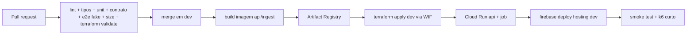

# 09 — Infraestrutura, Terraform e operação

## 1. Princípios

- Tudo que existe na nuvem é descrito em Terraform; o console serve para **ler**, não para criar.
- Nenhum recurso com custo fixo mensal (RNF-COST-04). Sem load balancer dedicado, NAT, Cloud SQL ou Memorystore.
- Duas contas de projeto: `pulso-dev` e `pulso-prod`, no mesmo billing account.
- Estado do Terraform no GCS, com *locking* nativo, um bucket por ambiente.
- Aplicação do Terraform é **manual e explícita** (`make infra-apply ENV=dev`); CI só faz `plan` e publica o resumo.

## 2. Estrutura

```
infra/terraform/
├── modules/
│   ├── apis/                 # habilita as APIs do projeto
│   ├── artifact/             # Artifact Registry
│   ├── data/                 # Firestore + buckets + IAM de dados
│   ├── runtime/              # Cloud Run service api + job ingest + SAs
│   ├── scheduler/            # Cloud Scheduler → job
│   ├── hosting/              # Firebase project/site + rewrite
│   └── observability/        # uptime, métricas, alertas, orçamento
├── envs/
│   ├── dev/  (main.tf, backend.tf, terraform.tfvars)
│   └── prod/ (main.tf, backend.tf, terraform.tfvars)
└── bootstrap/                # bucket de estado + APIs mínimas (uma vez)
```

Versões: Terraform ≥ 1.9, `hashicorp/google` ≥ 6.0, `hashicorp/google-beta` apenas se necessário para Firebase.

## 3. Recursos por ambiente

| Recurso | Nome | Configuração |
|---|---|---|
| APIs | run, firestore, storage, artifactregistry, cloudscheduler, logging, monitoring, billingbudgets, iam, firebase, cloudresourcemanager | habilitadas pelo módulo `apis` |
| Artifact Registry | `pulso` | Docker, `southamerica-east1`, limpeza de imagens > 10 |
| Cloud Run service | `pulso-api` | 512 MiB, 1 vCPU, concorrência 80, min 0 (1 na janela), max 6 (prod), timeout 30 s, `--no-allow-unauthenticated`? **público** via Hosting rewrite |
| Cloud Run Job | `pulso-ingest` | 512 MiB, timeout 55 s, taskCount 1, retries 1 |
| Cloud Scheduler | `pulso-ingest-1m` | `* * * * *`, fuso `America/Sao_Paulo`, OAuth com SA de ingestão, alvo `jobs:run` |
| Firestore | `(default)` | Native, `southamerica-east1`, modo produção |
| Bucket | `pulso-snapshots-{env}` | Standard, `southamerica-east1`, versionamento ligado, lifecycle 90 dias |
| Bucket | `pulso-assets-{env}` | geo/catálogo, cache público, versionamento desligado |
| Bucket | `pulso-tfstate-{env}` | versionamento + retenção 30 versões |
| Firebase | projeto + site `pulso-das-urnas-{env}` | Hosting com rewrite `/api/**` → `pulso-api` |
| Service Account | `sa-api` | `datastore.viewer`, `storage.objectViewer` |
| Service Account | `sa-ingest` | `datastore.editor`, `storage.objectCreator` **no bucket de snapshots** |
| Service Account | `sa-deploy` | `run.admin`, `artifactregistry.writer`, `iam.serviceAccountUser`, `storage.admin` (state) |
| Budget | `pulso-{env}` | US$ 10, alertas 50/80/100% |
| Uptime check | `/healthz` | 1 min, regiões São Paulo + Iowa |
| Alerta | 5xx > 1% (5 min) | log-based metric + policy |
| Alerta | lag de ingestão > 5 min | métrica customizada/publicada pela API |

### 3.1 Exposição pública da API
O serviço Cloud Run é invocado publicamente (`roles/run.invoker` para `allUsers`) porque a API é somente leitura e sem dados pessoais. A proteção é: CDN, rate limit na aplicação, limite de instâncias e orçamento.

### 3.2 Hosting
`firebase.json`:
```json
{
  "hosting": {
    "site": "pulso-das-urnas-prod",
    "public": "apps/web/dist",
    "ignore": ["**/.*"],
    "rewrites": [
      { "source": "/api/**", "run": { "serviceId": "pulso-api", "region": "southamerica-east1" } },
      { "source": "**", "destination": "/index.html" }
    ],
    "headers": [
      { "source": "/assets/**", "headers": [{ "key": "Cache-Control", "value": "public, max-age=31536000, immutable" }] }
    ]
  }
}
```
O rewrite para Cloud Run preserva os cabeçalhos `Cache-Control` da API, permitindo cache de CDN nas rotas de leitura. Esse comportamento é validado pelo AT-030.

## 4. Pipeline



- Autenticação GCP: **Workload Identity Federation** (sem chave JSON).
- `terraform plan` em PR, salvo como artefato; `apply` só em `dev`/tag.
- Deploy do frontend só depois do apply, para herdar variáveis e rewrites.
- Rollback: `gcloud run services update-traffic --to-revisions` e `firebase hosting:rollback`; documentado no runbook.
- Tag `v*` promove para `prod`; `main` só recebe release PR de `dev`.

## 5. Variáveis de ambiente

| Serviço | Variável | Exemplo |
|---|---|---|
| api | `DATA_MODE` | `real` (prod) / `fake` (local) |
| api | `GCP_PROJECT` | `pulso-prod` |
| api | `SNAPSHOT_BUCKET` | `pulso-snapshots-prod` |
| api | `ASSETS_BUCKET` | `pulso-assets-prod` |
| api | `CACHE_TTL_SECONDS` | `3` |
| api | `RATE_LIMIT_PER_MINUTE` | `60` |
| ingest | `ELECTION_WINDOW` | `17:00-23:59` |
| ingest | `MAX_RPS_TSE` | `5` |
| ingest | `CYCLE_SECONDS` | `10` |
| ingest | `CYCLE_COUNT` | `5` |
| ingest | `CONTACT_URL` | `https://github.com/rudineybarbosa/pulso-das-urnas` |
| web | `VITE_API_BASE` | `/api/v1` |
| web | `VITE_DATA_MODE` | `real` / `fake` |

Nenhuma variável é segredo. Se um dia houver, vai para Secret Manager e é referenciada por `value_source.secret_key_ref`.

## 6. Custo estimado

| Item | Free tier | Uso estimado (semana) | Custo |
|---|---|---|---|
| Firebase Hosting | 10 GB storage | 20 GB de banda | ~US$ 3,00 |
| Cloud Run (api) | 2 M req, 360 k GB-s | 1 M req, 100 k GB-s | US$ 0 |
| Cloud Run (job) | idem | 1.440 execuções × 55 s | ~US$ 0,40 |
| Firestore | 1 GiB, 50 k leituras/dia | ~100 k leituras/dia | ~US$ 0,06/dia |
| Cloud Storage | 5 GB | 2 GB | US$ 0 |
| Artifact Registry | 0,5 GB | 1 GB | ~US$ 0,10 |
| Scheduler | 3 jobs | 1 job | US$ 0 |
| **Total** | | | **< US$ 10** |

Fora da semana eleitoral, o custo tende a zero (min-instances 0, coleta a cada 30 min).

## 7. Runbook

### 7.1 Pré-eleição (D-7 a D-1)
- [ ] `terraform plan` limpo em prod; `apply` revisado.
- [ ] Deploy da versão candidata; smoke em `/healthz`, `/pleitos`, `/panorama`.
- [ ] Catálogo de 2026 carregado e validado (pleitos 3220/3221, cargos 1/3/5/6/7/8).
- [ ] Simulador testado nos cenários `virada`, `empate`, `fim`, `sem-votos`.
- [ ] Cores partidárias revisadas; build sem fallback inesperado.
- [ ] k6 de 10.000 VUs executado em dev com hit ratio e p95 registrados.
- [ ] Alertas e orçamento conferidos; contatos definidos.
- [ ] Cache-Control conferido na CDN (`x-cache: HIT`).

### 7.2 Dia da eleição
- [ ] 16h30: subir `min-instances=1` da API; rodar ingestão manual.
- [ ] 17h00: conferir primeiro snapshot e `ingest_lag_seconds`.
- [ ] A cada hora: dashboard (lag, 5xx, hit ratio, custo).
- [ ] 23h59: manter até o último estado finalizar; depois reduzir min-instances.

### 7.3 Incidentes
| Sintoma | Diagnóstico | Ação |
|---|---|---|
| Mapa branco com apuração em curso | `ingest_lag_seconds` alto | ver logs do job; checar status do TSE; rodar job manual |
| 5xx > 1% | logs da api, memória, timeout | rollback de revisão; aumentar max-instances temporariamente |
| Custo disparando | banda do Hosting, instâncias | reduzir `max-instances`, aumentar `s-maxage`, ativar `stale-if-error` |
| Snapshot inválido | logs de validação | ponteiro não avança; corrigir parser; republicar |
| Cores erradas | `fallback-colors.json` | corrigir `party-colors.json` e republicar assets |

### 7.4 Pós-eleição
- [ ] Congelar pleito (`finalizado`) e reduzir cadência.
- [ ] Exportar snapshots finais para o bucket de arquivo.
- [ ] Relatório de custo e de incidentes.
- [ ] Revisar fixtures com o formato real do pleito.

## 8. Pré-requisitos locais

- `gcloud` autenticado, `firebase-tools`, `terraform` ≥ 1.9, `docker`, Node 22, pnpm 9.
- O Terraform não é aplicado por este repositório sem `make infra-apply` explícito.
- `scripts/install-tools.sh` instala Terraform e Firebase CLI em `~/.local/bin` (sem sudo) quando ausentes.

## 9. Definição de pronto da infra

- `terraform fmt -check -recursive` e `terraform validate` verdes nos dois ambientes.
- `terraform plan` sem mudanças inesperadas após o apply.
- `curl /healthz` e `/api/v1/panorama` respondendo com cabeçalhos de cache corretos.
- Uptime check e alertas visíveis no console.
- Runbook revisado por quem vai operar no dia.
