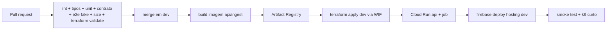

# 09 — Infraestrutura, Terraform e operação

## 1. Princípios

- Tudo que existe na nuvem é descrito em Terraform; o console serve para **ler**, não para criar.
- Nenhum recurso com custo fixo mensal (RNF-COST-04). Sem load balancer dedicado, NAT, Cloud SQL ou Memorystore.
- Duas contas de projeto: `pulso-dev` e `pulso-prod`, no mesmo billing account.
- Estado do Terraform no GCS, com *locking* nativo, um bucket por ambiente.
- Aplicação do Terraform é **manual e explícita** (`make infra-apply ENV=dev`); CI só faz `plan` e publica o resumo.

## 2. Estrutura

```
infra/terraform/
├── modules/
│   ├── apis/                 # habilita as APIs do projeto
│   ├── artifact/             # Artifact Registry
│   ├── data/                 # Firestore + buckets + IAM de dados
│   ├── runtime/              # Cloud Run service api + job ingest + SAs
│   ├── scheduler/            # Cloud Scheduler → job
│   ├── hosting/              # Firebase project/site + rewrite
│   └── observability/        # uptime, métricas, alertas, orçamento
├── envs/
│   ├── dev/  (main.tf, backend.tf, terraform.tfvars)
│   └── prod/ (main.tf, backend.tf, terraform.tfvars)
└── bootstrap/                # bucket de estado + APIs mínimas (uma vez)
```

Versões: Terraform ≥ 1.9, `hashicorp/google` ≥ 6.0, `hashicorp/google-beta` apenas se necessário para Firebase.

## 3. Recursos por ambiente

| Recurso | Nome | Configuração |
|---|---|---|
| APIs | run, firestore, storage, artifactregistry, cloudscheduler, logging, monitoring, billingbudgets, iam, firebase, cloudresourcemanager | habilitadas pelo módulo `apis` |
| Artifact Registry | `pulso` | Docker, `southamerica-east1`, limpeza de imagens > 10 |
| Cloud Run service | `pulso-api` | 512 MiB, 1 vCPU, concorrência 80, min 0 (1 na janela), max 6 (prod), timeout 30 s, `--no-allow-unauthenticated`? **público** via Hosting rewrite |
| Cloud Run Job | `pulso-ingest` | 512 MiB, timeout 55 s, taskCount 1, retries 1 |
| Cloud Scheduler | `pulso-ingest-1m` | `* * * * *`, fuso `America/Sao_Paulo`, OAuth com SA de ingestão, alvo `jobs:run` |
| Firestore | `(default)` | Native, `southamerica-east1`, modo produção |
| Bucket | `pulso-snapshots-{env}` | Standard, `southamerica-east1`, versionamento ligado, lifecycle 90 dias |
| Bucket | `pulso-assets-{env}` | geo/catálogo, cache público, versionamento desligado |
| Bucket | `pulso-tfstate-{env}` | versionamento + retenção 30 versões |
| Firebase | projeto + site `pulso-das-urnas-{env}` | Hosting com rewrite `/api/**` → `pulso-api` |
| Service Account | `sa-api` | `datastore.viewer`, `storage.objectViewer` |
| Service Account | `sa-ingest` | `datastore.editor`, `storage.objectCreator` **no bucket de snapshots** |
| Service Account | `sa-deploy` | `run.admin`, `artifactregistry.writer`, `iam.serviceAccountUser`, `storage.admin` (state) |
| Budget | `pulso-{env}` | dev US$ 1; prod US$ 10 (semana eleitoral) com limiar extra de 20% = US$ 2 (teto fora da eleição); alertas 50/80/100% — §6.1 |
| Uptime check | `/healthz` | 1 min, regiões São Paulo + Iowa |
| Alerta | 5xx > 1% (5 min) | métrica `run.googleapis.com/request_count` (5xx) + log estruturado da API; sem request log, que carregaria IP — §7.9 |
| Alerta | lag de ingestão > 5 min | métrica customizada/publicada pela API |
| Alerta | SLO 99,9% / queima de error budget | policy com dono nominal e escalonamento em 15 min — §7.6 |
| Logs | retenção | provedor/CDN 30 dias, sem sink de exportação — §7.9 |

**Acesso a buckets.** Todos os buckets com *uniform bucket-level access* e `public_access_prevention = "enforced"`: nenhum `allUsers`/`allAuthenticatedUsers`, nem para leitura. O que é público é a resposta cacheada da CDN, não o objeto nem o índice do bucket — `storage.objects.list` não é concedido fora das SAs de plataforma. `sa-api` só lê (`objectViewer`), `sa-ingest` só cria no bucket de snapshots, e o acesso é por nome de objeto conhecido.

### 3.1 Exposição pública da API
O serviço Cloud Run é invocado publicamente (`roles/run.invoker` para `allUsers`) porque a API é somente leitura e sem dados pessoais. A proteção é: CDN, rate limit na aplicação, limite de instâncias e orçamento.

### 3.2 Hosting
`firebase.json`:
```json
{
  "hosting": {
    "site": "pulso-das-urnas-prod",
    "public": "apps/web/dist",
    "ignore": ["**/.*"],
    "rewrites": [
      { "source": "/api/**", "run": { "serviceId": "pulso-api", "region": "southamerica-east1" } },
      { "source": "**", "destination": "/index.html" }
    ],
    "headers": [
      { "source": "/assets/**", "headers": [{ "key": "Cache-Control", "value": "public, max-age=31536000, immutable" }] },
      {
        "source": "**",
        "headers": [
          { "key": "Content-Security-Policy", "value": "default-src 'self'; img-src 'self' data:; style-src 'self'; script-src 'self'; connect-src 'self'; frame-ancestors 'none'; base-uri 'none'; form-action 'none'" },
          { "key": "Strict-Transport-Security", "value": "max-age=31536000; includeSubDomains; preload" },
          { "key": "X-Content-Type-Options", "value": "nosniff" },
          { "key": "Referrer-Policy", "value": "strict-origin-when-cross-origin" },
          { "key": "Permissions-Policy", "value": "geolocation=(), camera=(), microphone=()" }
        ]
      }
    ]
  }
}
```
O rewrite para Cloud Run preserva os cabeçalhos `Cache-Control` da API, permitindo cache de CDN nas rotas de leitura. Esse comportamento é validado pelo AT-030.

O bloco `**` acima é a superfície onde RNF-SEC-01/02 viram configuração: CSP, HSTS, `nosniff`, `Referrer-Policy` e `Permissions-Policy` para o HTML e os assets. Como o serviço Cloud Run também responde no URL direto (§3.1), a API repete os mesmos cabeçalhos no Fastify — nenhuma resposta protegida depende só da borda. A CSP não admite `unsafe-inline` nem `unsafe-hashes`: o CSS sai do build em arquivo e o mapa/corrida animam por CSSOM e variáveis CSS (08 §8).

## 4. Pipeline



- Autenticação GCP: **Workload Identity Federation** (sem chave JSON).
- `terraform plan` em PR, salvo como artefato; `apply` só com `workflow_dispatch`, tag ou quando o ambiente estiver configurado.
- Enquanto o WIF e os secrets (`GCP_WIF_PROVIDER`, `GCP_DEPLOY_SA`, `FIREBASE_TOKEN`) não existirem, o workflow Deploy fica **manual** e o publish é feito pelo runbook; nenhum push em `dev` dispara apply.
- Deploy do frontend só depois do apply, para herdar variáveis e rewrites.
- Rollback: `gcloud run services update-traffic --to-revisions` e `firebase hosting:rollback`; documentado no runbook.
- Tag `v*` promove para `prod`; `main` só recebe release PR de `dev`.

## 5. Variáveis de ambiente

| Serviço | Variável | Exemplo |
|---|---|---|
| api | `DATA_MODE` | `real` (prod) / `fake` (local) |
| api | `GCP_PROJECT` | `pulso-prod` |
| api | `SNAPSHOT_BUCKET` | `pulso-snapshots-prod` |
| api | `ASSETS_BUCKET` | `pulso-assets-prod` |
| api | `CACHE_TTL_SECONDS` | `3` |
| api | `RATE_LIMIT_PER_MINUTE` | `300` (origin; a CDN absorve o volume) |
| api | `RATE_LIMIT_BURST` | `600` |
| ingest | `ELECTION_WINDOW` | `17:00-23:59` |
| ingest | `PARSER_VERSION_PIN` | vazio (usa a versão do build); `1.4.2` fixa a anterior — §7.7 |
| ingest | `MAX_RPS_TSE` | `5` |
| ingest | `CYCLE_SECONDS` | `10` |
| ingest | `CYCLE_COUNT` | `5` |
| ingest | `CONTACT_URL` | `https://github.com/rudineybarbosa/pulso-das-urnas` |
| web | `VITE_API_BASE` | `/api/v1` |
| web | `VITE_DATA_MODE` | `real` / `fake` |

Nenhuma variável é segredo. Se um dia houver, vai para Secret Manager e é referenciada por `value_source.secret_key_ref`.

## 6. Custo estimado

| Item | Free tier | Uso estimado (semana) | Custo |
|---|---|---|---|
| Firebase Hosting | 10 GB storage | 20 GB de banda | ~US$ 3,00 |
| Cloud Run (api) | 2 M req, 360 k GB-s | 1 M req, 100 k GB-s | US$ 0 |
| Cloud Run (job) | idem | 1.440 execuções × 55 s | ~US$ 0,40 |
| Firestore | 1 GiB, 50 k leituras/dia | ~100 k leituras/dia | ~US$ 0,06/dia |
| Cloud Storage | 5 GB | 2 GB | US$ 0 |
| Artifact Registry | 0,5 GB | 1 GB | ~US$ 0,10 |
| Scheduler | 3 jobs | 1 job | US$ 0 |
| **Total** | | | **< US$ 10** |

Fora da semana eleitoral, o custo tende a zero (min-instances 0; coleta conforme RN-012: 30 min com apuração em andamento, 6 h sem pleito ativo).

### 6.1 Tetos por ambiente e kill switch

| Ambiente | Teto | Orçamento no Terraform |
|---|---|---|
| `pulso-dev` | **US$ 1/mês** | US$ 1, alertas 50/80/100% |
| `pulso-prod` (fora da eleição) | **US$ 2/mês** | limiar de 20% do orçamento de US$ 10 |
| `pulso-prod` (semana eleitoral) | **US$ 10** no total | US$ 10, alertas 50/80/100% |

O limiar de 20% (US$ 2) existe para avisar quando o regime normal estoura o teto mesmo dentro de um orçamento maior de semana eleitoral. Nenhum teto é ampliado por conveniência: ampliar exige ADR e aprovação (RNF-COST-04).

**Kill switch** — cortar custo sem deploy, em duas ações:

```bash
# 1) API para de aceitar tráfego (max-instances=0)
gcloud run services update pulso-api \
  --project=pulso-prod --region=southamerica-east1 --max-instances=0

# 2) ingestão para de rodar (nenhum ciclo novo, nenhuma chamada ao TSE)
gcloud scheduler jobs pause pulso-ingest-1m \
  --project=pulso-prod --location=southamerica-east1
```

- **Responsável:** o plantonista nominal do dia. Acionar é decisão do plantão; não depende de merge nem de `apply`.
- **Critério:** alerta em 100% do orçamento ou custo projetado acima do teto do ambiente por 2 leituras consecutivas do dashboard.
- **Efeito:** o site estático continua na CDN; as rotas `/api/**` passam a falhar e a CDN serve o último snapshot em cache enquanto o `stale-if-error` permitir (≤ 30 s na apuração e ≤ 6 h após finalizada, RNF-ESC-05). Registre horário, causa e ação em `docs/operacao/` (incidente).
- **Drift:** é uma ação fora do Terraform. Ao encerrar o incidente, reconcilie o valor no `terraform.tfvars` e rode `apply`; caso contrário o próximo `apply` reverte o kill switch sem aviso.
- **Volta:**

```bash
gcloud run services update pulso-api \
  --project=pulso-prod --region=southamerica-east1 --max-instances=6
gcloud scheduler jobs resume pulso-ingest-1m \
  --project=pulso-prod --location=southamerica-east1
```

Ao voltar, rode a ingestão manual e confira `ingest_lag_seconds` antes de considerar o incidente encerrado.

## 7. Runbook

### 7.1 Pré-eleição (D-7 a D-1)
- [ ] `terraform plan` limpo em prod; `apply` revisado.
- [ ] Deploy da versão candidata; smoke em `/healthz`, `/pleitos`, `/panorama`.
- [ ] Catálogo de 2026 carregado e validado (pleitos 3220/3221, cargos 1/3/5/6/7/8).
- [ ] Simulador testado nos cenários `virada`, `empate`, `fim`, `sem-votos`.
- [ ] Cores partidárias revisadas; build sem fallback inesperado.
- [ ] k6 de 10.000 VUs executado conforme §7.8 (3 runners, 5 min de platô) com relatório anexado.
- [ ] Kill switch ensaiado (§7.5) e retenção de logs em 30 dias conferida (§7.9).
- [ ] Alertas e orçamento conferidos; contatos definidos.
- [ ] Cache-Control conferido na CDN (`x-cache: HIT`).

### 7.2 Dia da eleição
- [ ] 16h30: subir `min-instances=1` da API; rodar ingestão manual.
- [ ] 17h00: conferir primeiro snapshot e `ingest_lag_seconds`.
- [ ] A cada hora: dashboard (lag, 5xx, hit ratio, custo).
- [ ] 23h59: manter até o último estado finalizar; depois reduzir min-instances.

### 7.3 Incidentes
| Sintoma | Diagnóstico | Ação |
|---|---|---|
| Mapa branco com apuração em curso | `ingest_lag_seconds` alto | ver logs do job; checar status do TSE; rodar job manual |
| 5xx > 1% | logs da api, memória, timeout | rollback de revisão; aumentar max-instances temporariamente |
| Custo disparando | banda do Hosting, instâncias | reduzir `max-instances`, aumentar `s-maxage`, ativar `stale-if-error`; sem estabilizar em 2 leituras, kill switch (§7.5) |
| Snapshot inválido | logs de validação, `parserVersion` | ponteiro não avança; fixar parser anterior (§7.7); corrigir e republicar |
| SLO queimando ou 5xx sustentado | error budget, uptime check | escalonamento em 15 min (§7.6); rollback da revisão |
| Cores erradas | `fallback-colors.json` | corrigir `party-colors.json` e republicar assets |

### 7.4 Pós-eleição
- [ ] Congelar pleito (`finalizado`) e reduzir cadência.
- [ ] Exportar snapshots finais para o bucket de arquivo.
- [ ] Relatório de custo e de incidentes.
- [ ] Revisar fixtures com o formato real do pleito.

### 7.5 Kill switch de custo

Aciona-se quando o orçamento bate 100% ou o custo projetado passa do teto do ambiente (dev US$ 1/mês; prod US$ 2/mês fora da eleição; US$ 10 na semana). Comandos, responsável e efeito estão em §6.1. Procedimento:

1. Registrar horário, ambiente, valor no dashboard e causa provável.
2. Executar as duas ações (API `max-instances=0` e `gcloud scheduler jobs pause pulso-ingest-1m`); confirmar com `gcloud run services describe pulso-api --project=pulso-prod --region=southamerica-east1 --format='yaml(spec.template.metadata.annotations)' | grep maxScale` (deve mostrar `'0'`) e `gcloud scheduler jobs describe pulso-ingest-1m --project=pulso-prod --location=southamerica-east1 --format='value(state)'` → `PAUSED`.
3. Avisar no canal do projeto que a API está fora; a CDN segue servindo o cache por até 30 s na apuração (6 h após finalizada).
4. Corrigir a causa antes de voltar; a volta é o inverso (`--max-instances=6` e `jobs resume`), seguida de ingestão manual e conferência de `ingest_lag_seconds`.
5. Se o corte passar de 30 min em janela eleitoral, isso consome error budget (§7.6) e vira incidente registrado.

### 7.6 SLO, error budget e escalonamento

- **SLO:** 99,9% de disponibilidade medido em **janela móvel de 30 dias**; **error budget de 43 min/mês** (RNF-OBS-06). A janela eleitoral (17h–23h59) é o período crítico, onde 99,9% equivale a **~25 s**; um corte perceptível na apuração consome o budget do mês e é registrado como incidente (§7.5, item 5).
- **Alerta:** política no Cloud Monitoring sobre o uptime check e a taxa de 5xx, com o campo `documentation` preenchido com o **nome do plantonista do dia**, o link deste runbook e o comando de kill switch. Alerta sem dono nominal é considerado quebrado.
- **Escalonamento:** sem reconhecimento em **15 min**, o alerta vai para o mantenedor secundário por telefone; sem resposta em mais 15 min, o mantenedor principal decide entre rollback e kill switch. Não há ferramenta paga de on-call (RNF-COST-04).
- **Budget queimado:** acima de 50% do budget mensal, congelar mudanças não essenciais e priorizar a causa; acima de 100%, só correções entram até o fim da janela.
- **Registro:** todo acionamento gera linha em `docs/operacao/` com horário de início, detecção, mitigação e encerramento.

### 7.7 Pin e rollback do parser

`parserVersion` é semver e vai gravado em cada snapshot (RNF-MAINT-06). Falha de schema **não avança o ponteiro**: o último snapshot válido continua servindo, o alerta dispara e o dado novo fica retido até a correção.

Fixar a versão anterior, sem novo build:

```bash
gcloud run jobs update pulso-ingest \
  --project=pulso-prod --region=southamerica-east1 \
  --update-env-vars=PARSER_VERSION_PIN=1.4.2

gcloud run jobs execute pulso-ingest \
  --project=pulso-prod --region=southamerica-east1 --wait
```

1. Confirme no snapshot publicado o campo `parserVersion` esperado e o avanço do ponteiro.
2. Registre o pin na variável do ambiente em `infra/terraform/envs/prod/terraform.tfvars`; sem isso, o próximo `apply` remove o pin e o problema volta em silêncio.
3. Corrija o parser com teste sobre a fixture que falhou; publique a versão nova (semver incrementado) e remova o pin com `--remove-env-vars=PARSER_VERSION_PIN` (e do `tfvars`, no mesmo PR).
4. O pin é temporário: não pode sobreviver à semana eleitoral sem issue aberta.

### 7.8 Teste de carga

- **Ambiente:** projeto `pulso-dev`, site `pulso-das-urnas-dev.web.app`, **CDN real** e os mesmos `Cache-Control` de produção. Fora da janela eleitoral. Teste sem CDN não vale como evidência.
- **Runners:** 3 (`k6` em São Paulo, Virgínia e Frankfurt), **10.000 VUs no total** (≈ 3.334 por runner), **5 min de platô**, mix **70% panorama / 20% município / 10% estático**.

```bash
# em cada runner, disparados no mesmo minuto
k6 run -e BASE_URL=https://pulso-das-urnas-dev.web.app \
       -e VUS=3334 -e DURATION=5m -e MIX=70/20/10 \
       --summary-export=out/carga-$(date +%F)-$(hostname).json load/panorama.js
```

O cenário em `load/panorama.js` recebe `VUS`, `DURATION` e `MIX`; a soma dos três runners é 10.000 VUs. Durante o platô, coletar do console: hit ratio da CDN, req/s no origin, CPU do `pulso-api` e contagem de 5xx. Aprovação só com **todos** os critérios de RNF-ESC-01 (05): erro < 0,1%, p95 na borda < 150 ms, origin ≤ 5%, CPU < 80%, zero 5xx. Relatório em `docs/operacao/carga-YYYY-MM-DD.md`, com data, commit, runners e números.

### 7.9 Retenção de logs e privacidade

- Cloud Logging com retenção de **30 dias**: bucket `_Default` configurado no Terraform (`google_logging_project_bucket_config`, `retention_days = 30`). **Nenhum sink de exportação** para Storage/BigQuery.
- Logs do provedor/CDN seguem a mesma janela de 30 dias, sem exportação (RNF-LGPD-05).
- Logs da aplicação **não contêm IP completo**: apenas `requestId`, rota, status, duração e versão do snapshot (RNF-OBS-02). IP, quando necessário para rate limit, existe só em memória como chave e nunca é persistido.
- **Request logs do Cloud Run** são a exceção a tratar explicitamente: a plataforma grava `httpRequest.remoteIp` por requisição e não há truncamento. Ficam **excluídos** por `google_logging_project_exclusion` `run-requests-sem-ip` com `log_id("run.googleapis.com/requests")`, de modo que nenhum IP chegue ao bucket. O alerta de 5xx usa a métrica `run.googleapis.com/request_count` (classe 5xx) somada ao log estruturado da própria API, que não tem IP — não o request log.
- Acesso aos logs restrito a `sa-deploy` e mantenedores; nenhum dado pessoal é registrado.
- Verificação:
  ```bash
  gcloud logging buckets describe _Default --location=global \
    --project=pulso-prod --format='value(retentionDays)'   # 30
  gcloud logging sinks list --project=pulso-prod           # só _Default e _Required
  gcloud logging exclusions list --project=pulso-prod      # inclui run-requests-sem-ip
  ```

## 8. Pré-requisitos locais

- `gcloud` autenticado, `firebase-tools`, `terraform` ≥ 1.9, `docker`, Node 22, pnpm 9.
- O Terraform não é aplicado por este repositório sem `make infra-apply` explícito.
- `scripts/install-tools.sh` instala Terraform e Firebase CLI em `~/.local/bin` (sem sudo) quando ausentes.

## 9. Definição de pronto da infra

- `terraform fmt -check -recursive` e `terraform validate` verdes nos dois ambientes.
- `terraform plan` sem mudanças inesperadas após o apply.
- `curl /healthz` e `/api/v1/panorama` respondendo com cabeçalhos de cache corretos.
- Uptime check e alertas visíveis no console.
- Orçamento por ambiente com o limiar extra de 20% em prod (§6.1); kill switch ensaiado.
- Retenção de logs do `_Default` em 30 dias e nenhum sink de exportação (§7.9).
- Runbook revisado por quem vai operar no dia.
